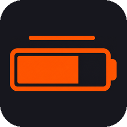

# Battery Monitor for SteelSeries Devices

<p align="center">
  
</p>

<p align="center">
  <strong>EN</strong> · Real battery levels from SteelSeries wireless gear, on your Apex Pro OLED and in a desktop window.<br>
  <strong>PL</strong> · Rzeczywisty poziom baterii sprzętu SteelSeries — na OLED Apex Pro i w oknie na pulpicie.
</p>

<p align="center">
  <a href="#english">English</a> ·
  <a href="#polski">Polski</a> ·
  <a href="docs/TECHNICAL.pl.md">Dokumentacja techniczna (PL)</a>
</p>


---

<a id="english"></a>

## English

### What it does

**Battery Monitor** reads the *real* battery percentage from SteelSeries mice and headsets (HID over the 2.4 GHz dongle, or Windows Bluetooth battery property) and shows it:

- on the **OLED screen** of an Apex Pro / Apex 7 keyboard (via SteelSeries GameSense),
- in a **desktop window** with tray icon, autostart, and Polish / English UI.

It also tracks how long each device has been *on* since the last charge, how many percent were used, and estimates remaining runtime from your own discharge history — not only from the manufacturer’s catalog numbers.

### How it works

```text
Dongle (HID) ──┐
               ├──► timeline (one battery, many links) ──► runtime estimate
Bluetooth ─────┘              │
                              ▼
                     window cards + OLED frames ──► GameSense ──► Apex OLED
```

1. **Read** — every minute the monitor polls known USB receivers and Bluetooth devices.
2. **Remember** — levels, charging state, and *on-time* go into a local history (`%APPDATA%\BatteryMonitor`). Cable, 2.4 GHz and Bluetooth share **one battery identity**, so switching a mouse to Bluetooth does not reset “on time” or “used %”. Discharge *rate* stays per-link (BT drains slower than 2.4 GHz).
3. **Estimate** — remaining hours blend the current session with closed cycles; until enough data exists, a catalog value with a `~` tilde is shown.
4. **Draw** — a full 128×40 bitmap is rendered and sent as GameSense `image-data` (the stock text layout cannot put runtime in the top-right corner).

SteelSeries GG is required **only for the keyboard screen**. Battery reads do not depend on GG — if Engine is down, the window still updates and the header shows “No screen”.

### Features

- Real HID / Bluetooth battery reads (not fake “connected = 100%”)
- OLED layout: device label, remaining time, large %, used since charge, charging animation
- On-time counter (ignores long offline gaps — sleep / powered off / closed app)
- Per-device cards, hardware picker, tray + Windows autostart
- Single-instance `.exe` (~21 MB) or run from source
- UI language: Polish / English

### Requirements

- Windows
- [SteelSeries GG](https://steelseries.com/gg) (Engine 3.13+) — for OLED only
- Keyboard with 128×40 OLED: Apex Pro, Apex Pro TKL, Apex 7, Apex 7 TKL
- Python 3.8+ — only if you run or build from source

### Install

**From source**

```powershell
git clone https://github.com/Jonasz135/Battery-Monitor-for-SteelSeries-Device.git
cd Battery-Monitor-for-SteelSeries-Device
pip install -r requirements.txt
pythonw app.py
```

**Build a single exe**

```powershell
python make_icons.py
python build.py
```

Output: `dist\BatteryMonitor.exe`. User data stays in `%APPDATA%\BatteryMonitor`, so you can move the exe anywhere.

### Supported devices (summary)

| Family | Examples | Notes |
| --- | --- | --- |
| Mice | Aerox 3/5/9, Prime, Rival 3/650… | 2.4 GHz + often Bluetooth |
| Headsets | Arctis Nova 7/5/4, Arctis 7/9… | Dongle HID protocols |
| OLED host | Apex Pro / 7 | Display only |

Exact Product IDs and protocols live in [`device_catalog.py`](device_catalog.py) and [`battery_hid.py`](battery_hid.py). Deep dive (cycles, glitch filters, GameSense, tests): **[technical docs in Polish](docs/TECHNICAL.pl.md)**.

### License / credit

Personal open-source project. Protocols were documented by communities such as [HeadsetControl](https://github.com/Sapd/HeadsetControl) and rivalcfg — this app only talks to *your* gear on *your* PC.

---

<a id="polski"></a>

## Polski

### Co robi program

**Battery Monitor** odczytuje *rzeczywisty* procent baterii myszy i słuchawek SteelSeries (HID przez dongle 2.4 GHz albo właściwość baterii Bluetooth w Windows) i pokazuje go:

- na **ekranie OLED** klawiatury Apex Pro / Apex 7 (przez GameSense),
- w **oknie na pulpicie** z ikoną w zasobniku, autostartem i interfejsem PL/EN.

Dodatkowo liczy, ile czasu urządzenie było *włączone* od ostatniego naładowania, ile procent ubyło, i szacuje pozostały czas pracy z Twojej historii rozładowania — nie tylko z katalogu producenta.

### Jak to działa

```text
Dongle (HID) ──┐
               ├──► oś czasu (jedna bateria, wiele łączy) ──► szacunek czasu
Bluetooth ─────┘              │
                              ▼
                     karty w oknie + klatki OLED ──► GameSense ──► OLED Apex
```

1. **Odczyt** — co minutę program odpytuje znane odbiorniki USB i urządzenia Bluetooth.
2. **Pamięć** — poziomy, ładowanie i *czas włączenia* trafiają do lokalnej historii (`%APPDATA%\BatteryMonitor`). Kabel, 2.4 GHz i Bluetooth to **jedna bateria**, więc przełączenie myszy na Bluetooth nie kasuje „Włączone” ani „zużyto %”. Tempo rozładowania liczy się osobno per łącze (BT zwykle schodzi wolniej).
3. **Szacunek** — pozostałe godziny to mieszanka bieżącej sesji i zamkniętych cykli; zanim zbierze się pomiar, widać wartość katalogową z tyldą `~`.
4. **Rysowanie** — cała klatka 128×40 jest renderowana i wysyłana jako `image-data` GameSense (domyślny układ tekstu nie pozwala wstawić czasu pracy w prawym górnym rogu).

SteelSeries GG jest potrzebne **wyłącznie do ekranu klawiatury**. Odczyt baterii działa bez GG — gdy Engine nie działa, karty w oknie nadal się odświeżają, a w nagłówku widać „Bez ekranu”.

### Funkcje

- Prawdziwy odczyt HID / Bluetooth (nie „połączone = 100%”)
- OLED: etykieta, czas pracy, duży %, zużycie od naładowania, animacja ładowania
- Licznik czasu włączenia (długie przerwy — sen, wyłączony sprzęt, zamknięty program — nie wchodzą do licznika)
- Karty urządzeń, deklaracja sprzętu, zasobnik + autostart Windows
- Jeden plik `.exe` (~21 MB) albo uruchomienie ze źródeł
- Język interfejsu: polski / angielski

### Wymagania

- Windows
- [SteelSeries GG](https://steelseries.com/gg) (Engine 3.13+) — tylko pod OLED
- Klawiatura z OLED 128×40: Apex Pro, Apex Pro TKL, Apex 7, Apex 7 TKL
- Python 3.8+ — tylko przy uruchomieniu lub budowie ze źródeł

### Instalacja

**Ze źródeł**

```powershell
git clone https://github.com/Jonasz135/Battery-Monitor-for-SteelSeries-Device.git
cd Battery-Monitor-for-SteelSeries-Device
pip install -r requirements.txt
pythonw app.py
```

**Budowa jednego exe**

```powershell
python make_icons.py
python build.py
```

Wynik: `dist\BatteryMonitor.exe`. Dane użytkownika zostają w `%APPDATA%\BatteryMonitor`, więc `.exe` możesz przenieść gdzie chcesz.

### Obsługiwany sprzęt (skrót)

| Rodzina | Przykłady | Uwagi |
| --- | --- | --- |
| Myszy | Aerox 3/5/9, Prime, Rival 3/650… | 2.4 GHz + często Bluetooth |
| Słuchawki | Arctis Nova 7/5/4, Arctis 7/9… | protokoły HID dongle’a |
| Ekran OLED | Apex Pro / 7 | tylko wyświetlacz |

Pełna lista PID-ów i protokołów: [`device_catalog.py`](device_catalog.py), [`battery_hid.py`](battery_hid.py).  
Szczegóły (cykle, filtry błędów, GameSense, testy): **[dokumentacja techniczna](docs/TECHNICAL.pl.md)**.


### Struktura projektu

| Plik / katalog | Rola |
| --- | --- |
| `app.py` | Okno CustomTkinter, zasobnik, autostart |
| `monitor_service.py` | Pętla odczytu i wysyłki na OLED |
| `battery_hid.py` / `battery_bluetooth.py` | Odczyt baterii |
| `battery_timeline.py` / `runtime_estimator.py` | Historia i szacunek czasu pracy |
| `device_catalog.py` | Katalog modeli |
| `oled_render.py` | Bitmapa 128×40 |
| `i18n.py` | Tłumaczenia PL/EN |
| `build.py` | Pakowanie do `.exe` |
| `test_*.py` | Testy bez sprzętu |

### Podziękowania

Protokoły HID pochodzą m.in. z projektów open source takich jak [HeadsetControl](https://github.com/Sapd/HeadsetControl). Program działa lokalnie na Twoim PC i nie wysyła danych do chmury.
