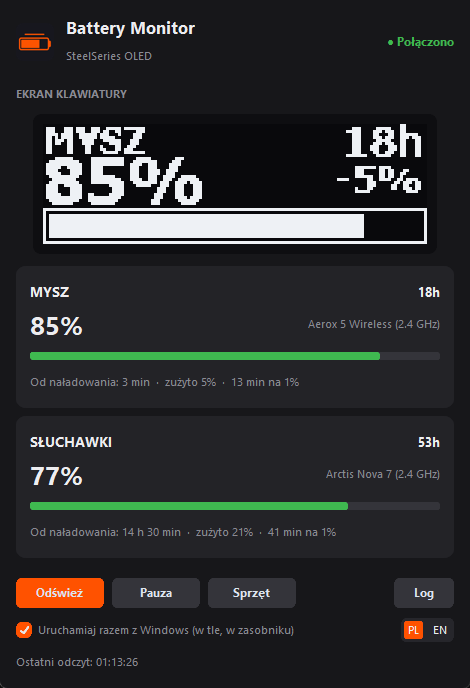
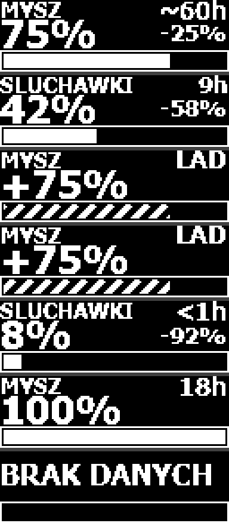
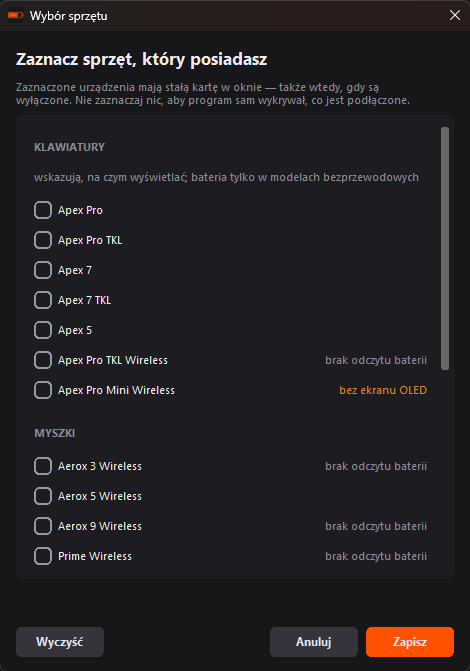

> Dokumentacja techniczna (PL). Opis projektu po polsku i angielsku: [README.md](../README.md).
# Monitor baterii SteelSeries na OLED Apex Pro

Program odczytuje **rzeczywisty** poziom baterii bezprzewodowych urządzeń SteelSeries
i wyświetla go na ekranie OLED klawiatury Apex Pro, korzystając z lokalnego API
GameSense SDK. Obsługuje oba sposoby podłączenia: 2.4 GHz przez odbiornik USB
oraz Bluetooth.

Program buduje się do jednego pliku `BatteryMonitor.exe`, który potrafi
uruchamiać się razem z Windows i siedzieć w zasobniku systemowym. Ten sam silnik
obsługuje trzy sposoby uruchomienia: spakowany `.exe`, okno ze źródeł (`app.py`)
i skrypt konsolowy do diagnostyki (`battery_oled.py`).



Interfejs jest po polsku albo po angielsku, do wyboru przełącznikiem w oknie.

Ekran przełącza się cyklicznie między urządzeniami. Nazwa urządzenia jest w lewym
górnym rogu, przybliżony czas pracy w prawym górnym rogu, poniżej duży procent,
obok niego licznik zużycia od ostatniego naładowania (`-18%`), a na dole pasek
naładowania. Podczas ładowania przed procentem pojawia się `+`, pasek wypełnia się
animowanymi ukośnymi kreskami, a licznik zużycia znika — opisuje zakończoną sesję,
podczas gdy poziom właśnie rośnie.

Nazwa i procent są w osobnych wierszach celowo — razem w jednej linii zajmowały
całą szerokość i wymuszały drobną, nieczytelną czcionkę.



Podgląd można odświeżyć bez dotykania klawiatury:

```powershell
python oled_render.py
```

## Dlaczego własna bitmapa

Handler ekranu w GameSense SDK potrafi tylko układać linie tekstu jedna pod drugą
na całą szerokość — nie ma żadnego pozycjonowania w konkretnym miejscu ekranu.
Umieszczenie czasu pracy w prawym górnym rogu wymaga więc narysowania całej klatki
128x40 samodzielnie i wysłania jej jako `image-data` (SDK to obsługuje).

Efekt uboczny jest korzystny: mamy pełną kontrolę nad każdym pikselem, dzięki czemu
animacja ładowania też jest nasza, a rozmiar czcionki dobiera się automatycznie do
dostępnego miejsca — długie `SLUCHAWKI` samo się zmniejsza, zamiast nachodzić na
czas pracy, a krótkie `MYSZ` zostaje duże.

Wysokość 40 pikseli jest ciasna, więc podział pionowy jest kompromisem: 11 pikseli
na nazwę z czasem, 16 na procent, wiersz odstępu i 12 na pasek. Pasek poniżej
około 10 pikseli przestaje działać — ukośne kreski animacji rozpadają się wtedy
na kropki.

## Wymagania

- Windows z uruchomionym **SteelSeries GG** (Engine 3.13.0 lub nowszy — starsze
  wersje nie obsługują wieloliniowych ekranów ani paska postępu)
- Klawiatura z ekranem 128x40: Apex Pro, Apex Pro TKL, Apex 7, Apex 7 TKL
- Python 3.8+ — tylko do uruchomienia ze źródeł albo zbudowania `.exe`

SteelSeries GG jest potrzebne **wyłącznie do rysowania po ekranie klawiatury**.
Poziom baterii odczytywany jest bezpośrednio z urządzeń przez HID i nie ma z GG nic
wspólnego, dlatego gdy GG nie działa, karty w oknie nadal pokazują aktualne
wartości, a w nagłówku widnieje `● Bez ekranu`. Serwis ponawia próbę połączenia co
10 sekund, więc uruchomienie GG w dowolnym momencie zapala ekran samo — nie trzeba
restartować monitora. Kolejność startu też nie ma znaczenia, co jest istotne przy
autostarcie: oba programy startują razem z zalogowaniem i wygrać może dowolny.

## Instalacja

### Gotowy program (zalecane)

```powershell
pip install -r requirements.txt
python make_icons.py
python build.py
```

Wynikiem jest **`dist\BatteryMonitor.exe`** — jeden plik, który można skopiować
gdziekolwiek i uruchamiać dwuklikiem. Dane (historia baterii, wybór sprzętu) trafiają
do `%APPDATA%\BatteryMonitor`, więc program działa też z katalogu tylko do odczytu
i przeniesienie `.exe` niczego nie gubi.

Rozmiar to około 21 MB, bo w środku siedzi interpreter Pythona z Tk. Start trwa
2-3 sekundy — tryb jednoplikowy najpierw rozpakowuje zawartość do katalogu
tymczasowego. Dla programu, który uruchamia się raz na sesję i potem siedzi
w zasobniku, to nie ma znaczenia; szczegóły decyzji są w
[BatteryMonitor.spec](../BatteryMonitor.spec).

### Ze źródeł

```powershell
pip install -r requirements.txt
pythonw app.py
```

`pythonw` zamiast `python` uruchamia okno bez towarzyszącej konsoli. Odczyt
Bluetooth woła PowerShell, ale z flagą `CREATE_NO_WINDOW`, więc czarne okno nie
mignie co minutę. Do szukania błędów lepsze jest `python app.py` — ma konsolę,
na której widać wyjątek przy starcie.

Wersja konsolowa robi dokładnie to samo, tylko bez okna, i kończy się przez Ctrl+C:

```powershell
python battery_oled.py
```

Po uruchomieniu w SteelSeries GG, w sekcji GameSense, pojawi się aplikacja
**Battery Monitor** — tam można zmienić sposób wyświetlania albo wyłączyć efekt.

Szybki test samego odczytu baterii, bez wysyłania czegokolwiek na OLED:

```powershell
python battery_hid.py         # urządzenia na 2.4 GHz
python battery_bluetooth.py   # urządzenia na Bluetooth
python paths.py               # gdzie program trzyma dane i zasoby
python autostart.py           # co siedzi we wpisie autostartu
```

## Autostart i praca w tle

Checkbox **Uruchamiaj razem z Windows (w tle, w zasobniku)** w stopce okna dopisuje
program do klucza rejestru `HKEY_CURRENT_USER\...\CurrentVersion\Run`. Wpis zawiera
flagę `--tray`, dzięki której program startuje od razu do zasobnika, bez wyskakującego
okna przy każdym zalogowaniu.

Klucz użytkownika, a nie `HKEY_LOCAL_MACHINE` ani Harmonogram zadań, z trzech powodów:
zaznaczenie checkboxa nie wywołuje okna kontroli konta; monitor czyta baterię *tych*
urządzeń i rysuje po *tej* klawiaturze, więc uruchamianie go na koncie innej osoby
nie miałoby sensu; a start po zalogowaniu, a nie przy starcie systemu, i tak jest
tym, czego chcemy, bo SteelSeries GG startuje w tym samym momencie.

Rejestr jest tu **jedynym źródłem prawdy** — stan checkboxa czytany jest wprost
z niego, a nie z `settings.json`. Duplikat w pliku ustawień mógłby się z rejestrem
rozjechać i pokazywać zaznaczony autostart, który nie działa. Gdy wpis wskazuje na
plik, którego już nie ma (program został przeniesiony albo skasowany), najbliższe
uruchomienie poprawia go po cichu. Warunkiem jest **brak pliku**, a nie sama różnica
ścieżki: gdyby wystarczyła różnica, jedno uruchomienie ze źródeł przestawiałoby
autostart z `.exe` na `pythonw app.py`.

Program pilnuje też, żeby działał w jednym egzemplarzu — patrz
[single_instance.py](../single_instance.py). Blokadą jest nazwany mutex Windows,
a nie plik blokady, bo plik zostaje po awaryjnym zamknięciu i przy następnym starcie
wyglądałby jak działająca instancja; mutex system zwalnia sam, nawet po zabiciu
procesu. Bez tego autostart plus jedno kliknięcie ikony dawałyby dwie kopie, które
wysyłają do GameSense konkurencyjne klatki (ekran migocze), nadpisują sobie plik
historii i gubią odczyty HID, odbierając odpowiedzi na cudze pytania. Druga kopia
uruchomiona ręcznie mówi, gdzie szukać pierwszej; uruchomiona z autostartu kończy
się bez słowa, bo nikt wtedy na ekran nie patrzy.

## Okno

Okno pokazuje dokładnie tę klatkę, która w danej chwili jest na klawiaturze —
razem z animacją ładowania, bo podgląd odświeża się 10 razy na sekundę. Poniżej
karta każdego wykrytego urządzenia: nazwa łącza, procent, kolorowy pasek
(zielony powyżej 50%, pomarańczowy 20-50%, czerwony poniżej 20%, pomarańczowy
przy ładowaniu) i szacowany czas pracy. Czas wyszarzony z tyldą to szacunek
katalogowy, jasny bez tyldy to zmierzone tempo rozładowania.

Pod paskiem jest wiersz podsumowania sesji: czas pracy od ostatniego naładowania,
zużycie i średni czas na jednym procencie
(`Włączone: 4 h 52 min · zużyto 20% · 14 min na 1%`) — tutaj z minutami, bo
to zmierzony czas włączenia, a nie przewidywanie. Liczy się tylko czas, gdy monitor
widzi urządzenie online; wyłączenie sprzętu nie wydłuża licznika. `nieznane` oznacza,
że program nie widział momentu odłączenia kabla; pojawi się po pierwszym ładowaniu
przy działającym monitorze.

Trzy liczby są w jednym wierszu, a nie w trzech, bo karta ma stałą wysokość —
każdy dodatkowy wiersz podnosiłby ją o kilkanaście pikseli razy liczba urządzeń.

**Czas na 1%** to to samo tempo rozładowania, tylko odwrócone: zamiast „ile
punktów na godzinę" mówi „ile czasu na jednym punkcie". Ta sama informacja, ale
czytelniejsza — `14 min na 1%` od razu daje wyobrażenie, ile zostało z
osiemdziesięciu procent, podczas gdy `1,7 pkt/h` wymaga dzielenia w głowie.
Jednostką są minuty, nie pełne godziny: typowa mysz schodzi punkt na kilkanaście
minut, więc zaokrąglenie jak w czasie pozostałym zamieniłoby cały wskaźnik
w `<1h`. Liczba jest **tylko w oknie** — na ekranie 128x40 nie ma dla niej miejsca
obok procentu, czasu pracy i licznika zużycia, a dorysowanie jej kosztowałoby
czytelność tego, co tam już jest.

Licznik zużycia milczy dokładnie w tych samych sytuacjach co czas od naładowania,
i to nie przypadek — oba opisują tę samą sesję. Bez zaobserwowanego odłączenia kabla
pierwsza próbka nie jest poziomem po naładowaniu, a poziomem z chwili, w której
program zaczął patrzeć; różnica względem niej byłaby zużyciem od uruchomienia
programu, podpisanym jako zużycie od naładowania. Zero też się nie wyświetla — tuż
po odłączeniu kabla `zużyto 0%` jest prawdą, która niczego nie wnosi.

Przyciski w stopce: **Odśwież** wymusza natychmiastowy odczyt bez czekania na
kolejną minutę, **Pauza** wstrzymuje wysyłanie na klawiaturę, ale nie odczyty —
podgląd i karty działają dalej, ekran po kilkunastu sekundach wraca do swojej
zwykłej zawartości. **Sprzęt** otwiera deklarację posiadanych urządzeń (opisaną
niżej). **Log** rozwija panel diagnostyczny, przydatny przy sprawdzaniu, dlaczego
urządzenie pokazuje `BRAK DANYCH`. Pod nimi wiersz ustawień programu: checkbox
autostartu (opisany wyżej) i przełącznik języka (opisany niżej).

Krzyżyk **zwija okno do zasobnika systemowego**, a nie zamyka programu — monitor
musi działać ciągle, inaczej GameSense po 15 sekundach oddałby ekran z powrotem.
Program kończy się przez pozycję *Zakończ* w menu ikony w zasobniku. Podpowiedź
nad ikoną pokazuje skrót stanu, np. `MYSZ 95%  SŁUCHAWKI 95%`.

W oknie używane są pełne polskie znaki (`SŁUCHAWKI`); ograniczenie do samych
liter bez diakrytyków dotyczy wyłącznie ekranu OLED.

Ikonę i logo generuje [make_icons.py](../make_icons.py) z pliku
`../assets/logo_source.png`. Rozmiary 16-24 px dostają uproszczony rysunek — samą
baterię, bez kreski symbolizującej ekran, bo przy tej wielkości zlewała się ona
z ramką baterii w nieczytelną plamę.

## Język interfejsu

Program mówi po polsku albo po angielsku. Przełącznik `PL`/`EN` jest w prawym dolnym
narożniku okna, obok checkboxa autostartu, a wybór **działa od razu, bez restartu**:
napisy w oknie, na kartach urządzeń, w menu zasobnika i na ekranie klawiatury
zmieniają się w tej samej chwili.

Domyślnie program idzie za językiem **interfejsu Windows** — pytamy o
`GetUserDefaultUILanguage`, a nie o ustawienia regionalne, bo ktoś może mieć polski
format daty przy angielskim systemie. W `settings.json` zapisane jest wtedy
`"language": "auto"`, czyli życzenie „jak w systemie", a nie konkretny kod. To
rozróżnienie ma znaczenie: zapisanie wykrytego języka zamroziłoby go na zawsze przy
pierwszym uruchomieniu. Kliknięcie przełącznika zapisuje już konkretne `"pl"` albo
`"en"` — skoro użytkownik wybrał ręcznie, program ma ten wybór trzymać także wtedy,
gdy Windows zmieni swój.

Napisy siedzą w [i18n.py](../i18n.py), po jednym słowniku na język, z kluczami
grupowanymi po miejscu, w którym się pojawiają (`card.`, `status.`, `picker.`,
`log.`, `oled.`). Bez gettextu — kompilowanie plików `.mo` i katalog `locale` obok
programu dokładałyby więcej obsługi, niż dają przy dwóch językach.

Parametry wchodzą przez `str.format`, nie przez składanie napisów po kawałku:
kolejność słów w zdaniu różni się między językami, więc `"Połączono ({address})"`
musi być jednym napisem, a nie napisem plus adresem doklejonym z boku. Serwis
z tego samego powodu nie oddaje gotowych zdań — jego stan to **klucz tłumaczenia
plus parametry**, a napis powstaje dopiero w oknie, w chwili rysowania. Bez tego
przełączenie języka zostawiłoby w stopce zdanie w poprzednim języku do najbliższej
zmiany stanu, czyli czasem na kilka minut.

Napisy na ekran OLED (`oled.*`) muszą być czystym ASCII w **obu** językach —
czcionka jest binaryzowana do jednego bitu i nie gwarantuje diakrytyków, więc
`SŁUCHAWKI` wyszłoby tam jako `S UCHAWKI`. Pilnuje tego test. W oknie żadnego
takiego ograniczenia nie ma, dlatego ten sam zestaw słuchawek jest na ekranie
podpisany `SLUCHAWKI`, a w oknie `SŁUCHAWKI`.

Etykieta urządzenia z katalogu (`MYSZ`, `SLUCHAWKI`, `KLAWIATURA`) zostaje
**nietłumaczonym tokenem**. Logika używa jej do rozpoznawania urządzeń — po niej
odsiewane są podwójne odczyty tej samej myszy z HID i z Bluetooth — więc zmiana
języka nie może jej ruszać. Tłumaczenie wchodzi dopiero przy wyświetlaniu, przez
`i18n.oled_label()` i `i18n.window_label()`.

Wersja konsolowa czyta zapisany wybór, ale nie ma czego przełączać. Komunikat
o drugiej uruchomionej kopii idzie w języku systemu, bo pojawia się przed
zbudowaniem interfejsu, gdy ustawienia nie są jeszcze wczytane.

Podgląd obu słowników obok siebie:

```powershell
python i18n.py
```

## Wybór sprzętu



Program działa w dwóch trybach, a przełącza się między nimi sama treść wyboru —
nie ma osobnego przełącznika, bo dwa źródła prawdy zawsze się rozjeżdżają.

**Tryb automatyczny** (nic nie zaznaczone, stan domyślny). Odpytywane jest
wszystko, co znajdzie się na USB i co da się rozpoznać po katalogu urządzeń. Nic
nie trzeba ustawiać, ale urządzenia wyłączonego nie da się odróżnić od
nieistniejącego — w obu przypadkach dongle po prostu nie odpowiada, więc karta
znika.

**Tryb deklaracji** (zaznaczone modele). Odpytywane są tylko one, a każde ma stałą
kartę: wyłączone pokazuje myślnik i `Wyłączone`, zamiast znikać. Zero byłoby tu
mylące, bo sugerowałoby baterię na wyczerpaniu, a o poziomie nie wiemy nic.

Klawiatury są na liście po to, żeby dało się ostrzec o braku ekranu. Zaznaczenie
modelu bez OLED-u (Apex Pro Mini Wireless) pokazuje ostrzeżenie, bo program nie
miałby wtedy gdzie wyświetlać. Klawiatury przewodowe nie dostają karty baterii, bo
nie mają czego na niej pokazać, a bezprzewodowe dostają ją z dopiskiem o braku
obsługi — ich baterii nie udostępnia żaden znany interfejs (szczegóły w sekcji
[Czego nie da się odczytać](#czego-nie-da-się-odczytać)).

Dopisek `brak odczytu baterii` przy modelu znaczy, że jest on w katalogu, ale nie
mamy potwierdzonego w źródłach protokołu HID — dotyczy to klawiatur bezprzewodowych
i Arctis Nova 4. Taka pozycja jest widoczna i jawnie oznaczona, zamiast udawać, że
działa: wpisanie zgadywanego Product ID byłoby gorsze niż brak wpisu, bo program
wysyłałby komendę konfiguracyjną do niewłaściwego urządzenia tego samego
producenta.

Wybór zapisuje się w `settings.json` i wchodzi w życie od razu: serwis wczytuje
ustawienia od nowa i wykonuje natychmiastowy odczyt.

### Katalog urządzeń

[device_catalog.py](../device_catalog.py) jest jedynym źródłem prawdy o tym, jaki
sprzęt program zna: nazwa, kategoria, ekran, łącza, Product ID i katalogowy czas
pracy. Jak z urządzeniem rozmawiać, opisują rodziny protokołów w
[battery_hid.py](../battery_hid.py) — katalog wskazuje je tylko z nazwy, więc dodanie
modelu korzystającego ze znanego protokołu to jeden wpis, bez zmian w kodzie
odczytu.

Podgląd katalogu wraz ze stanem obsługi:

```powershell
python device_catalog.py
```

## Dwie drogi odczytu

Poziom baterii pobierany jest inaczej w zależności od sposobu podłączenia, bo
w trybie Bluetooth nie ma odbiornika USB, któremu można zadać pytanie po HID.

| Podłączenie | Moduł | Metoda |
| --- | --- | --- |
| 2.4 GHz (dongle USB) | `battery_hid.py` | zapytanie HID do interfejsu vendorowego odbiornika |
| Bluetooth | `battery_bluetooth.py` | właściwość PnP Windows `DEVPKEY_Bluetooth_Battery` |

Jeśli to samo urządzenie jest widoczne obiema drogami naraz (mysz sparowana po
Bluetooth i jednocześnie podłączona przez dongle), wygrywa odczyt z 2.4 GHz — to
aktywne łącze i tylko ono podaje informację o ładowaniu.

Ograniczenie drogi Bluetooth: Windows udostępnia tę właściwość tylko dla urządzeń,
które same raportują baterię po BT, i nie podaje informacji o ładowaniu.

## Obsługiwane urządzenia (2.4 GHz)

Odczyt baterii działa dla **wszystkich myszek i słuchawek z listy poza Arctis
Nova 4** — to jedenaście rodzin protokołów obejmujących ponad pięćdziesiąt Product
ID, razem z wariantami regionalnymi i kolejnymi rewizjami sprzętu.

| Rodzina | Modele | Zapytanie | Poziom baterii |
| --- | --- | --- | --- |
| `aerox` | Aerox 3 / 5 / 9 Wireless, Prime Wireless, Prime Mini Wireless | `0x00 0xd2` bezprzewodowo, `0x00 0x92` na kablu | numer kroku po 5 punktów |
| `rival` | Rival 3 Wireless | `0x00 0xaa 0x01` | procent wprost |
| `rival_650` | Rival 650 Wireless | `0x00 0xaa 0x01` | procent wprost |
| `nova_pro` | Arctis Nova Pro Wireless | `0x06 0xb0` (31 bajtów) | skala 0-8 |
| `nova_7` | Arctis Nova 7, 7P, 7X | `0x00 0xb0` | skala 0-4 **albo** procent, zależnie od PID-u |
| `nova_5` | Arctis Nova 5, 5X | `0x00 0xb0` | procent wprost |
| `arctis_7_plus` | Arctis 7+, 7P+, 7X+ | `0x00 0xb0` | skala 0-4 |
| `arctis_7` | Arctis 7, Arctis Pro 2019 | `0x06 0x18` | procent wprost |
| `arctis_1` | Arctis 1 Wireless, Arctis 7P, Arctis 7X | `0x06 0x12` | procent wprost |
| `arctis_9` | Arctis 9 | `0x00 0x20` | surowy zakres `0x64`-`0x9a` |
| `arctis_pro_wireless` | Arctis Pro Wireless | `0x41 0xaa`, potem `0x40 0xaa` | skala 0-4 |

Cztery rzeczy z tej tabeli warto znać, zanim się w niej czegoś zmieni.

**Ta sama komenda nie znaczy tego samego protokołu.** `0x00 0xb0` wysyłają Nova 7,
Nova 5 i Arctis 7+, a poziom baterii siedzi u nich w innym bajcie i w innej skali.
Dlatego są to trzy osobne rodziny, a nie jedna — pilnuje tego test, który tę samą
ramkę podaje wszystkim trzem parserom i sprawdza, że wyniki się różnią.

**Nova 7 wybiera skalę po Product ID, nie po treści odpowiedzi.** Aktualizacja
firmware ze stycznia 2026 zmienia PID egzemplarza i przełącza go ze skali 0-4 na
procenty. Lista PID-ów raportujących krokami jest w `battery_hid` jako
`_NOVA_7_DISCRETE_PIDS`; pomylenie jej daje odczyt „4%" tam, gdzie bateria jest
pełna.

**Arctis 7P i 7X bez plusa nie należą do rodziny Arctis 7.** Dzielą protokół
z Arctis 1 Wireless. Nazwa handlowa nic tu nie mówi o protokole.

**Rival 3 Wireless nie ma PID-u kablowego** i nie jest to luka w danych: ta mysz
chodzi na bateriach AAA i nie ma portu ładowania.

Wpisy jednego modelu dla różnych łącz to **jedno urządzenie** — na kablu zgłasza
się pod innym Product ID niż na dongle'u. W katalogu są więc jednym modelem
z PID-ami pogrupowanymi per łącze, co jest warunkiem działania śledzenia cykli
ładowania (szczegóły w sekcji o szacowanym czasie pracy).

Urządzenia wykrywane są przy każdym odczycie, więc wypięcie dongle'a albo
wyłączenie myszki nie wymaga restartu programu.

Protokoły pochodzą z projektów, które je udokumentowały:
[HeadsetControl](https://github.com/Sapd/HeadsetControl) dla słuchawek Arctis
i [rivalcfg](https://github.com/flozz/rivalcfg) dla myszek. Nic tu nie zostało
zgadnięte — model bez potwierdzonego źródła ma w katalogu puste `pids`
i w oknie wyboru dopisek `brak odczytu baterii`.

### Czego nie da się odczytać

**Klawiatury nie podają swojej baterii — żadna, w żadnym modelu.** Nie jest to
przeoczenie: sprawdzone zostały OpenRGB, apex-tux, steelseriesgg-rs, rivalcfg oraz
sterownik `hid-steelseries` z jądra Linuksa, a żaden nie zna komendy baterii dla
klawiatur SteelSeries. GameSense SDK też jej nie udostępnia — pozwala pisać po
ekranie, ale nie pytać o stan sprzętu. Apex Pro TKL Wireless pokazuje więc baterię
myszy i słuchawek, ale własnej nie zna. Zmiana tego wymagałaby przechwycenia
ruchu USB podczas pracy SteelSeries GG i odtworzenia komendy z podsłuchu.

**Arctis Nova 4** nie występuje w HeadsetControl w żadnej postaci, więc nie ma dla
niej ani jednego potwierdzonego Product ID.

**Arctis 9X i nowsza rewizja Nova 5X** (`0x2264`) są znane z nazwy, ale ich
protokół nie jest potwierdzony — świadomie nie ma ich w katalogu.

Na Bluetooth nie ma PID-u, więc model rozpoznawany jest po nazwie zgłaszanej przez
Windows (`bt_names` w katalogu — na przykład „Aerox 5 WL"). Dopasowanie jest po
jawnej liście nazw, a nie po fragmencie tekstu: „Arctis 7" jest przedrostkiem
„Arctis 7P", więc zgadywanie wybierałoby zły model i przypisywało mu obcy
katalogowy czas pracy. Urządzenia nieznane katalogowi nadal się pokazują —
dostają etykietę rodziny (`Aerox`, `Arctis`, `Rival`, `Sensei`, `Prime`, `Apex`)
z `_LABELS` w [battery_bluetooth.py](../battery_bluetooth.py).

## Szacowany czas pracy

Logika jest rozdzielona na dwa moduły: [battery_timeline.py](../battery_timeline.py)
odpowiada wyłącznie za dane, a [runtime_estimator.py](../runtime_estimator.py) wyłącznie
za matematykę. Kalkulator nie dotyka dysku i nie wie, skąd biorą się liczby, więc
da się go testować na danych z palca, bez sprzętu.

### Oś czasu

Każdy rekord to cztery wartości: `timestamp`, poziom baterii 0-100, `is_charging`
i łącze, którym przyszedł odczyt. Zapis na dysk następuje **tylko wtedy, gdy
odczyt coś wnosi**:

- zmienił się stan ładowania (to granica cyklu, zawsze warta zapisu),
- poziom zmienił się o co najmniej punkt procentowy,
- urządzenie odezwało się z innego łącza niż poprzednio,
- to pierwszy odczyt urządzenia,
- albo narosło co najmniej kilka minut czasu włączenia przy niezmienionym poziomie
  (inaczej restart gubiłby godziny, w których bateria stała w miejscu).

Poza tym `record()` nie rusza dysku. Poprzednia wersja przepisywała cały plik przy
każdym odczycie, czyli raz na minutę na każde urządzenie, mimo że poziom baterii
zmienia się co kilkadziesiąt minut.

**Czas włączenia, nie zegar ścienny.** Licznik „Włączone", długość cykli
i tempo rozładowania opierają się na czasie włączenia: sumie odcinków między
kolejnymi udanymi odczytami, o ile przerwa nie przekracza około trzech cykli
odpytywania. Wyłączenie myszy/słuchawek, zamknięcie programu albo sen komputera
daje dużą lukę i wypada z mianownika — inaczej noc z wyłączonym sprzętem sztucznie
zaniżałaby zużycie i zawyżała przewidywany czas pracy. Program liczy tylko to, co
sam zobaczył online; bez dodatkowego protokołu „device awake" nie da się inaczej.

W pliku `battery_timeline.json` trzymana jest **bieżąca sesja** w pełni oraz
**podsumowania zamkniętych cykli** — start, koniec, poziomy, czas włączenia
i łącze zamiast setki próbek. Tempo rozładowania da się z nich odtworzyć dokładnie, więc
pełna historia byłaby marnowaniem miejsca. Wybrałem JSON, a nie SQLite, bo przy
takiej filtracji jedno urządzenie generuje około stu rekordów na cykl — baza
danych dodałaby zależność i odebrała możliwość zajrzenia do pliku edytorem, nie
dając nic w zamian.

Zapis idzie przez plik tymczasowy i `os.replace`, więc przerwanie w trakcie nie
zostawia uszkodzonego pliku. Gdyby jednak plik był popsuty, monitor startuje
z czystą historią, zamiast się wywrócić.

### Cykle ładowania

Oś czasu zapamiętuje dokładny moment, w którym `is_charging` przeszło z `true` na
`false` — czyli odłączenia kabla. Od niego narasta czas włączenia pokazywany
w oknie jako „Włączone" oraz licznik zużytych procent (`drop_since_charge`).
Gdy program wystartował przy urządzeniu już pracującym na baterii, tego momentu po
prostu nie znamy i oba widnieją wtedy jako `nieznane`. Zmyślanie ich (na przykład od
chwili uruchomienia programu) dałoby liczby wyglądające wiarygodnie i będące
nieprawdą.

Licznik zużycia nie schodzi poniżej zera. Urządzenia raportują poziom skokowo
i potrafią się o punkt „cofnąć" w górę bez ładowania, a `ubyło -1%` nie znaczy nic
sensownego.

Rozpoczęcie ładowania zamyka bieżącą sesję i dopisuje ją do historii — ale tylko
jeśli cokolwiek z niej wynika: co najmniej 10 punktów spadku w co najmniej pół
godziny. Cykl z 100% na 95% nie mówi nic o tempie, a zaniżyłby średnią.

### Jedna bateria, kilka łączy

Historia prowadzona jest **per bateria, nie per łącze** — kluczem jest klucz
modelu z [device_catalog.py](../device_catalog.py), wspólny dla dongle'a, kabla
i Bluetootha. Aerox po podłączeniu kabla zgłasza się pod innym PID-em niż na
dongle'u, a po Bluetooth Windows nazywa go jeszcze inaczej („Aerox 5 WL").
Przy kluczowaniu nazwą ładowanie trafiałoby do jednego wpisu, praca na baterii
do drugiego, a przełączenie myszy na Bluetooth zaczynałoby sesję od zera —
licznik „Włączone" i zużyte procenty nie miałyby od czego liczyć. Na Bluetooth
byłoby to nie do naprawienia z samego łącza: Windows nie zgłasza tam ładowania,
więc osobna historia BT nigdy nie zobaczyłaby początku sesji i zostałaby
z `nieznane` na zawsze.

Tempa mieszać jednak nie wolno: producent podaje dla Aeroxa 180 h na Bluetooth
wobec 80 h na 2.4 GHz. Dlatego każda próbka i każdy cykl nosi swoje łącze, czas
włączenia narasta osobno dla każdego z nich, a przewidywany czas pracy bierze
pod uwagę **tylko pomiary z łącza używanego w tej chwili** — zarówno bieżącą
sesję, jak i zamknięte cykle. Zaraz po przesiadce na Bluetooth wynik wraca więc
do wartości katalogowej z tyldą i schodzi z niej, gdy uzbiera się pomiar z tego
łącza. Liczniki „Włączone" i „zużyto" sumują wszystkie łącza, bo opisują jedną
baterię, a nie jeden sposób podłączenia.

Gdyby to samo urządzenie odpowiedziało na obu PID-ach w jednym cyklu odpytywania,
pierwszeństwo ma odczyt zgłaszający ładowanie, bo tylko wpis kablowy wie o nim
prawdę. Pierwszy odczyt po zmianie łącza dostaje też luźniejszy próg wykrywania
„potajemnego naładowania" (15 zamiast 3 punktów): każde łącze mierzy tę samą
baterię własną miarką i skok o kilka punktów przy przesiadce nie znaczy, że coś
przybyło.

### Przewidywane tempo

Tempo to średnia ważona dwóch składników:

| Składnik | Waga | Skąd |
| --- | --- | --- |
| Tempo bieżącej sesji | 70% | spadek / czas włączenia od odłączenia kabla |
| Tempo historyczne | 30% | ostatnie 5 zamkniętych cykli (też czas włączenia) |

Bieżąca sesja waży więcej, bo opisuje dzisiejszy sposób używania: jasność
podświetlenia, częstotliwość odpytywania, głośność. Historia stabilizuje wynik,
gdy sesja jest jeszcze krótka. Gdy dostępny jest tylko jeden składnik, brany jest
w całości — mieszanie go z zerem przesuwałoby wynik zależnie od tego, czego brakuje,
zamiast oprzeć się na tym, co wiadomo.

Tempo historyczne to suma spadków przez sumę czasów, a nie średnia arytmetyczna
temp poszczególnych cykli. Inaczej dwugodzinny cykl ważyłby tyle samo co
czterdziestogodzinny, choć mówi o urządzeniu znacznie mniej.

Pozostały czas to poziom baterii podzielony przez to tempo, **zaokrąglony do
pełnych godzin** (`14h`). Przy tempie mierzonym w punktach na godzinę i baterii
raportowanej co 5 punktów minuty byłyby pozorną dokładnością. Poniżej godziny
pokazywane jest `<1h`, bo `0h` sugerowałoby, że urządzenie już się wyłączyło.

Jedna subtelność: przy płaskim poziomie monitor i tak woła `record()` co minutę.
Te heartbeaty naliczają `active_seconds`, więc godziny bez zmiany procentu
wydłużają szacunek — urządzenie naprawdę trzyma się dłużej, niż wynikało z samego
spadku. Gdy odczytów nie ma (sprzęt wyłączony), czas się nie nalicza.

Z tego samego tempa bierze się **średni czas na jednym procencie**, pokazywany na
karcie urządzenia: to po prostu jego odwrotność. Liczony jest z gotowego
`Estimate.rate`, a nie po raz drugi z osi czasu — wyszłaby ta sama liczba, tylko
z ryzykiem, że kiedyś rozjedzie się z czasem pracy pokazanym obok. Zerowe albo
nieznane tempo daje pusty napis, a nie dzielenie przez zero.

### Przypadki brzegowe

| Sytuacja | Zachowanie |
| --- | --- |
| Brak historii | wartość katalogowa producenta, oznaczona tyldą (`~54h`) |
| Nieznane urządzenie bez danych katalogowych | pusty napis, zamiast liczby z sufitu |
| Trwa ładowanie | brak szacunku, na ekranie `LAD` (`CHG` po angielsku) |
| Nienaturalny skok baterii | odczyt pominięty do potwierdzenia następnym |
| Wzrost poziomu bez flagi ładowania | sesja zamknięta, nowa startuje bez znanego początku |
| Bardzo powolne rozładowanie | wynik przycięty do 999 h |

Progu odsiewania błędnych odczytów **nie da się oprzeć na samym tempie**: Aerox
raportuje baterię w krokach po 5 punktów, więc legalny krok między dwoma odczytami
co minutę to chwilowe 300 punktów na godzinę. Dlatego odrzucany jest tylko duży
spadek w krótkim czasie — co najmniej 25 punktów w mniej niż kwadrans. Żadne z tych
urządzeń nie jest w stanie tyle stracić w kwadrans, a spadek o 70 punktów po dobie
z wyłączonym komputerem przechodzi bez przeszkód. Odrzucony odczyt nie jest
zapominany: gdy następny go potwierdzi, zostaje przyjęty.

| Urządzenie | 2.4 GHz | Bluetooth |
| --- | --- | --- |
| Aerox 5 Wireless | 80 h | 180 h |
| Arctis Nova 7 Gen 2 | 54 h | 42 h |

Rozróżnienie na tyldę ma znaczenie, bo wartości producenta są optymistyczne —
testy redakcyjne Aeroxa 5 pokazują często 18-20 h zamiast obiecanych 80 h, zależnie
od podświetlenia i częstotliwości odpytywania. Dlatego gdy tylko pomiar jest gotowy,
ma pierwszeństwo nad katalogiem.

### Testy

```powershell
python test_battery_runtime.py
python test_devices.py
python test_i18n.py
```

82 testów bez pytest i bez sprzętu. Pierwszy plik pokrywa politykę zapisu,
wykrywanie granic cykli, czas włączenia (z wyłączeniem luk offline), wagi średniej,
licznik zużycia, formatowanie czasu na 1% i wszystkie przypadki brzegowe z tabeli
powyżej — każdy podstawia własne znaczniki czasu, więc czterdziestogodzinny cykl
rozładowania sprawdza się w milisekundach.

Drugi pilnuje spójności katalogu, trybu deklaracji, parserów odpowiedzi HID oraz
rzeczy związanych z uruchamianiem: ścieżek danych, poprawności wpisu autostartu
i blokady pojedynczej instancji. Testy autostartu **czytają** rejestr, ale go nie
modyfikują, a test blokady używa własnej nazwy mutexa — inaczej wynik zależałby od
tego, czy program właśnie działa, a test odbierałby mu blokadę.
Najważniejszy test katalogu sprawdza, czy jeden Product ID nie wskazuje dwóch
modeli: katalog wpisuje się ręcznie, a jedna literówka wysłałaby komendę
konfiguracyjną do niewłaściwego urządzenia. Podobnie sprawdzane jest, czy każde
łącze z PID-ami ma przypisaną komendę — bez niej odczyt cicho zwracałby brak
danych, a wpis w katalogu sugerowałby, że model jest obsługiwany.

Testy parserów istnieją, bo pod ręką są dwa urządzenia z katalogu, a rodzin
protokołów jedenaście. Dla pozostałych to jedyna dostępna weryfikacja: składają
odpowiedź taką, jaką opisują źródła, i sprawdzają, czy parser czyta właściwy bajt
we właściwej skali. Błąd przesunięcia o jeden bajt daje tu poziom baterii odczytany
z bajtu statusu — liczbę wyglądającą sensownie i zupełnie nieprawdziwą.

Trzeci plik sprawdza to, czego nie widać przy klikaniu po interfejsie: czy oba
języki mają te same klucze, czy żaden napis nie jest pusty, czy napisy na ekran OLED
zmieściły się w ASCII i czy zdania z parametrami mają w obu językach te same pola.
Ostatnie jest najbardziej podstępne — literówka w `{adress}` pokazałaby użytkownikowi
surowy wzorzec zamiast adresu serwera, i to tylko w jednym języku, w jednym rzadko
odwiedzanym miejscu okna.

Podgląd zebranych danych:

```powershell
python battery_timeline.py
```

### Migracja ze starego formatu

Poprzedni plik `battery_history.json` trzymał pary `[czas, procent]` bez stanu
ładowania i kasował całą historię przy każdym ładowaniu — czyli systematycznie
niszczył pełne cykle, na których opiera się teraz tempo historyczne. Przy pierwszym
uruchomieniu jego próbki są przenoszone do nowego pliku jako bieżąca sesja (to
dokładnie one w nim zostawały), więc pomiar zbierany godzinami nie przepada. Stary
plik zostaje nietknięty i przestaje być używany.

### Gdzie leżą dane

Historia i ustawienia trafiają do `%APPDATA%\BatteryMonitor`, a nie obok programu —
patrz [paths.py](../paths.py). Powód widać dopiero po spakowaniu: tryb jednoplikowy
PyInstallera rozpakowuje zawartość do katalogu tymczasowego i **usuwa go przy
zamknięciu programu**. Zapis obok „pliku programu" oznaczałby, że historia zbierana
godzinami przepada przy każdym zamknięciu okna, a szacowanie startuje od zera.

Ta sama ścieżka obowiązuje w obu trybach uruchomienia. Gdyby wersja ze źródeł
trzymała dane obok skryptu, a spakowana w `%APPDATA%`, przejście na `.exe`
wyglądałoby jak utrata całej historii. Pliki z poprzednich wersji, leżące jeszcze
obok skryptu, są przy pierwszym uruchomieniu **kopiowane** (nie przenoszone) do
nowej lokalizacji, więc powrót do starszej wersji programu wciąż ma swoje dane.

## Jak to działa

1. **Odczyt baterii** — `battery_hid.py` otwiera interfejs vendorowy odbiornika,
   wysyła komendę zapytania o status i parsuje odpowiedź; `battery_bluetooth.py`
   czyta właściwość PnP przez PowerShell. Numer interfejsu zależy od rodziny
   protokołu (myszki i większość Arctisów: 3, Nova Pro: 4, Arctis 7: 5, Arctis 9
   i Pro Wireless oraz Rival 650: 0), a usage page nie dla wszystkich modeli jest
   potwierdzone — dopasowanie ścieżki HID jest więc stopniowe, bo Windows często
   podaje numer interfejsu jako `-1`. Odczyt jest pasywny, żadne ustawienia
   urządzenia nie są zmieniane.
2. **Renderowanie** (`oled_render.py`) — rysuje klatkę 128x40 i zwraca ją jako
   640 bajtów (jeden bit na piksel, najstarszy bit pierwszy), czyli w formacie,
   którego wymaga GameSense.
3. **Wyświetlanie** (`monitor_service.py`) — czyta
   `%PROGRAMDATA%\SteelSeries\SteelSeries Engine 3\coreProps.json`, bierze z niego
   klucz `address`, a następnie wysyła:
   - `POST /game_metadata` — rejestruje aplikację `BATTERY_MONITOR`,
   - `POST /bind_game_event` — binduje zdarzenie `BATTERY` z handlerem ekranu
     (`device-type: screened-128x40`, `zone: one`, `mode: screen`),
   - `POST /game_event` — wysyła gotową klatkę w kluczu `image-data-128x40`
     danych kontekstowych, co nadpisuje domyślny obraz z bindowania.

Poziom baterii odpytywany jest co 60 sekund, ale zdarzenia lecą co 4 sekundy.
Jest to celowe: GameSense dezaktywuje aplikację po 15 sekundach bez zdarzeń, więc
częstsza wysyłka jednocześnie rotuje urządzenia na ekranie i utrzymuje efekt aktywny.

Animacja ładowania napędzana jest z Pythona (`ANIMATION_FPS`, domyślnie 10 klatek
na sekundę), bo dynamiczny obraz przekazuje się w danych zdarzenia, a SDK przyjmuje
tylko jedną klatkę na zdarzenie — nie da się zabindować animowanej sekwencji bitmap
po stronie Engine. Urządzenia, które się nie ładują, dostają jedną statyczną klatkę
i żadnego dodatkowego ruchu.

Dwie rzeczy decydują o tym, czy animacja jest płynna:

- **Wzór przesuwa się o dokładnie jeden piksel na klatkę**, na podstawie licznika
  całkowitego. Wcześniej przesunięcie liczyło się z fazy 0..1 mnożonej przez okres
  wzoru i zaokrąglanej w dół, co przy 10-pikselowym okresie dawało rytm
  1-1-1-2 piksela — animacja szarpała co czwartą klatkę.
- **Klatki są planowane na sztywnej osi czasu.** Zwykły `sleep` po każdym wysłaniu
  dodawałby do odstępu czas odpowiedzi Engine, więc tempo falowałoby razem
  z obciążeniem maszyny.

Licznik klatek przechodzi między kolejnymi cyklami wyświetlania tego samego
urządzenia, więc wzór nie skacze do początku przy każdym obrocie pętli.

Wyłączenie GG nie zabija programu — po błędzie łączności próbuje ponownie co 10 sekund
i przechodzi pełną rejestrację od nowa (po restarcie GG port może być inny). Odczyty
baterii lecą dalej także wtedy, gdy GG nie działa, bo poziom naładowania da się
odczytać niezależnie od niego — okno pozostaje więc użyteczne.

## Podział na serwis i interfejs

Cała praca dzieje się w `MonitorService` z [monitor_service.py](../monitor_service.py),
w osobnym wątku. Okno i skrypt konsolowy to tylko dwie skorupy wokół tego samego
serwisu. Trzy rozwiązania sprawiają, że działa to z interfejsem graficznym:

- **Pauzy są przerywalne.** Zamiast `time.sleep` serwis używa `Event.wait`
  w odcinkach po 50 ms, więc zamknięcie programu kończy pracę natychmiast, a nie
  po doczekaniu do końca czterosekundowego cyklu ekranu. Przycisk *Odśwież* też
  przerywa trwającą pauzę.
- **Stan udostępniany jest jako migawka** (`get_snapshot()`), którą okno odpytuje
  we własnym tempie. Klatki powstają 10 razy na sekundę i przepychanie każdej z nich
  przez kolejkę tylko po to, by narysować najnowszą, byłoby marnotrawstwem.
- **Komunikaty idą przez wywołanie zwrotne**, więc konsola je wypisuje, a okno
  wrzuca do panelu logu.
- **Stan wychodzi jako klucz tłumaczenia z parametrami**, nie jako gotowe zdanie.
  Napis powstaje w oknie, w chwili rysowania stopki, więc przełączenie języka
  odświeża i ją.

Żelazna zasada: wątek serwisu nigdy nie dotyka widgetów, bo tkinter nie jest
bezpieczny wątkowo. Akcje z menu zasobnika wracają do wątku okna przez
`after(0, ...)`, bo pystray woła je z własnego wątku.

## Gdy urządzenie pokazuje "BRAK DANYCH"

Odbiornik USB jest widoczny w systemie także wtedy, gdy samo urządzenie jest
wyłączone — wtedy zwraca wartość nieprawidłową (mysz Aerox zwraca `0xff`,
słuchawki Nova zwracają status `0x00`). Skrypt traktuje to jako brak danych
i pomija takie urządzenie w rotacji.

Warto wiedzieć, że odbiornik nadaje własne raporty statusu kilkadziesiąt razy na
sekundę, a SteelSeries GG odpytuje urządzenie równolegle. Dlatego odpowiedź na
własne zapytanie rozpoznawana jest po echu opcodu w pierwszym bajcie — bez tego
łatwo wziąć przypadkowy raport z tego strumienia za poziom baterii.

Jeśli wszystkie urządzenia są wyłączone, na ekranie pojawia się `BRAK DANYCH`.
Po włączeniu urządzenia wartość pojawi się w ciągu kilku sekund — w tym stanie
skrypt ponawia odczyt przy każdym obrocie pętli, nie czekając pełnej minuty.

Warto też wiedzieć, że niektóre modele aktualizują raportowany procent dość
rzadko, więc wartość może chwilę "stać" w miejscu.

## Konfiguracja

Stałe na górze `monitor_service.py`:

| Stała | Znaczenie |
| --- | --- |
| `BATTERY_POLL_SECONDS` | jak często odpytywać baterię (domyślnie 60) |
| `SCREEN_ROTATE_SECONDS` | jak często przełączać urządzenie na ekranie (domyślnie 4) |
| `RECONNECT_DELAY_SECONDS` | pauza przed ponowną próbą po błędzie (domyślnie 10) |
| `ANIMATION_FPS` | klatki na sekundę animacji ładowania (domyślnie 10) |

Napis pokazywany, gdy żadne urządzenie nie odpowiada, daje funkcja
`no_data_label()` — funkcja, a nie stała, bo język można zmienić w trakcie
działania programu, a stała zapamiętałaby napis z chwili importu modułu.

Wygląd okna — `app.py`:

| Stała | Znaczenie |
| --- | --- |
| `WINDOW_WIDTH` | szerokość okna; wysokość dobiera się do liczby urządzeń |
| `PREVIEW_ZOOM` | powiększenie podglądu ekranu (domyślnie 3, czyli 384x120) |
| `TICK_MS` | jak często okno odświeża się z migawki serwisu (domyślnie 100) |
| `LEVEL_WARN`, `LEVEL_LOW` | progi zmiany koloru paska |
| `OLED_ON`, `OLED_OFF` | kolory podglądu ekranu |
| `DETAIL_SEPARATOR` | separator członów w wierszu podsumowania na karcie |

Wygląd ekranu — `oled_render.py`:

| Stała | Znaczenie |
| --- | --- |
| `BAR_TOP`, `BAR_BOTTOM` | pionowy zakres paska naładowania |
| `STRIPE_PERIOD`, `STRIPE_WIDTH` | gęstość i grubość ukośnych kresek animacji |
| `_LABEL_SIZES`, `_VALUE_SIZES`, `_RUNTIME_SIZES`, `_USED_SIZES` | rozmiary czcionki, z których dobierany jest największy pasujący |
| `RUNTIME_MAX_WIDTH` | limit szerokości czasu pracy, by nazwie zostało miejsce |
| `USED_MAX_WIDTH` | limit szerokości licznika zużycia, by procent został duży |
| `_THRESHOLD` | próg binaryzacji; niżej = grubsze, bardziej widoczne litery |

Wagi i progi szacowania — `runtime_estimator.py`:

| Stała | Znaczenie |
| --- | --- |
| `WEIGHT_SESSION`, `WEIGHT_HISTORY` | wagi średniej ważonej (domyślnie 0.7 i 0.3) |
| `HISTORY_CYCLES` | ile ostatnich cykli wchodzi do tempa historycznego (domyślnie 5) |
| `MIN_SESSION_DROP` | minimalny spadek, by zaufać bieżącej sesji (domyślnie 5) |
| `MIN_SESSION_HOURS` | minimalny czas bieżącej sesji (domyślnie 0.5 h) |
| `MAX_ESTIMATE_HOURS` | górne przycięcie wyniku (domyślnie 999 h) |
| `MAX_PER_POINT_HOURS` | górne przycięcie czasu na 1% (ta sama granica) |

Katalogowe czasy pracy, używane jako punkt startowy przed pierwszym pomiarem, są
w `rated_hours` w [device_catalog.py](../device_catalog.py) — osobno dla 2.4 GHz
i Bluetootha, bo różnią się nawet dwukrotnie. Modele, dla których producent podaje
jedną zbiorczą liczbę bez rozbicia na łącza, mają wpisane tylko to, co da się
potwierdzić; brak wartości znaczy, że program poczeka na własny pomiar, zamiast
pokazać zmyśloną liczbę.

Polityka zapisu i odsiewanie odczytów — `battery_timeline.py`:

| Stała | Znaczenie |
| --- | --- |
| `MIN_LEVEL_DELTA` | najmniejsza zmiana poziomu trafiająca na dysk (domyślnie 1) |
| `CHARGE_TOLERANCE` | wzrost poziomu uznawany za ładowanie bez flagi (domyślnie 3) |
| `GLITCH_MIN_DROP`, `GLITCH_MAX_ELAPSED_SECONDS` | co uznajemy za błędny odczyt (25 punktów w mniej niż 900 s) |
| `MIN_CYCLE_DROP`, `MIN_CYCLE_HOURS` | kiedy zamknięta sesja trafia do historii (10 punktów, 0.5 h) |
| `MAX_CYCLES`, `MAX_SAMPLES` | limity rozmiaru pliku (10 cykli, 400 próbek na sesję) |
| `MAX_ONLINE_GAP` | najdłuższa przerwa między odczytami liczona jako czas włączenia (180 s) |
| `ACTIVE_SAVE_SECONDS` | co ile narosłych sekund włączenia schodzimy na dysk przy płaskim poziomie (300 s) |

Napisy interfejsu — `i18n.py`:

| Stała | Znaczenie |
| --- | --- |
| `LANGUAGES` | obsługiwane kody języków (`pl`, `en`) |
| `AUTO` | wartość „jak w systemie", zapisywana domyślnie w `settings.json` |
| `DEFAULT_LANGUAGE` | język awaryjny, gdy wykrycie systemowego zawiedzie |
| `LANGUAGE_NAMES` | podpisy na przełączniku w oknie |
| `OLED_KEYS` | klucze, których treść musi być czystym ASCII |

Etykiety urządzeń (`label` w `device_catalog.py`) warto trzymać krótkie i bez
polskich znaków — OLED nie gwarantuje poprawnego renderowania diakrytyków. Pilnują
tego testy w `test_devices.py` i `test_i18n.py`. Sam token pozostaje
nietłumaczony; wersję do wyświetlenia dają `i18n.oled_label()` i
`i18n.window_label()`.

Klucze modeli (`key` w katalogu) trafiają do `settings.json`, więc ich zmiana po
wydaniu skasowałaby użytkownikowi zapisany wybór. To samo dotyczy `ENTRY_NAME`
w `autostart.py`: pod starą nazwą zostałby osierocony wpis, który dalej uruchamiałby
program, podczas gdy checkbox pokazywałby autostart jako wyłączony.

## Pliki

| Plik | Rola |
| --- | --- |
| `app.py` | okno, podgląd ekranu, karty urządzeń, ikona w zasobniku, autostart |
| `monitor_service.py` | serwis w wątku: klient GameSense, rotacja i animacja ekranu |
| `battery_oled.py` | uruchomienie serwisu z konsoli |
| `battery_hid.py` | odczyt baterii przez HID (2.4 GHz) |
| `battery_bluetooth.py` | odczyt baterii urządzeń Bluetooth |
| `oled_render.py` | rysowanie klatki 128x40, generowanie `preview.png` |
| `device_catalog.py` | katalog modeli: PID-y, łącza, ekrany, czasy katalogowe |
| `i18n.py` | napisy interfejsu po polsku i angielsku, wykrywanie języka systemu |
| `settings.py` | zapis deklaracji posiadanego sprzętu i wyboru języka |
| `battery_timeline.py` | oś czasu odczytów, cykle ładowania, polityka zapisu |
| `runtime_estimator.py` | matematyka przewidywania pozostałego czasu pracy |
| `paths.py` | gdzie leżą dane (`%APPDATA%`) i zasoby (wnętrze `.exe`) |
| `autostart.py` | wpis w kluczu `Run` rejestru, flaga `--tray` |
| `single_instance.py` | mutex pilnujący jednego egzemplarza programu |
| `build.py` | budowanie `.exe` wraz ze sprawdzeniem zależności |
| `BatteryMonitor.spec` | przepis PyInstallera i uzasadnienie decyzji pakowania |
| `test_battery_runtime.py` | testy osi czasu i kalkulatora na danych syntetycznych |
| `test_devices.py` | testy katalogu, ustawień, parserów HID i uruchamiania |
| `test_i18n.py` | testy kompletności tłumaczeń, ASCII na OLED i zapisu języka |
| `make_icons.py` | budowanie `assets/logo.png` i `assets/icon.ico` |

Pliki danych, tworzone automatycznie w `%APPDATA%\BatteryMonitor`:

| Plik | Rola |
| --- | --- |
| `battery_timeline.json` | historia odczytów i cykli ładowania |
| `settings.json` | zadeklarowany sprzęt i wybrany język |
| `battery_history.json` | plik w starym formacie, tylko do jednorazowej migracji |

## Poza zakresem

Nie ma instalatora — `BatteryMonitor.exe` kopiuje się ręcznie tam, gdzie ma leżeć.
Skrótu na pulpicie ani w menu Start program sobie nie tworzy.

Klawiatury SteelSeries nie mają znanego protokołu odczytu baterii, więc modele
bezprzewodowe pokazują swój poziom tylko w SteelSeries GG, nie tutaj — szczegóły
w sekcji „Czego nie da się odczytać".

Języków jest dwa i dodanie trzeciego wymaga dopisania słownika w `i18n.py`, a nie
podłożenia pliku z tłumaczeniem — nie ma katalogu `locale` ani wczytywania napisów
z zewnątrz.
